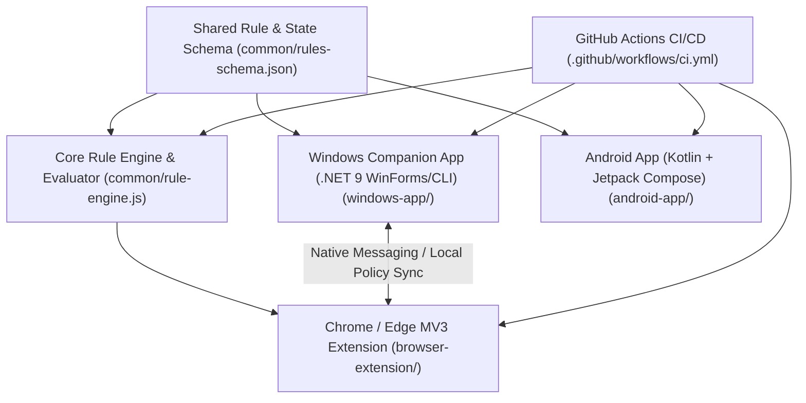

# ZEROFEED — Architecture, Feasibility & Technical Audit (Phase 1)

## 1. Repository & Environment Audit
- **Workspace Status**: Clean initialization inside `C:\Users\Dali\.gemini\antigravity\scratch\zerofeed`.
- **Available Toolchains Verified**:
  - **Node.js**: `v26.5.0` / `npm 11.17.0` (Cross-device rule engine, automated test suite, browser extension tooling)
  - **.NET SDK**: `9.0.825` (Native lightweight Windows companion & background watchdog/CLI/UI)
  - **JDK & Android SDK**: OpenJDK 17 (`17.0.20`) + Android SDK (`android-35` / `android-36`, build-tools `36.0.0`)
  - **Git & GitHub CLI**: Git `2.47.1` + `gh 2.96.0` authenticated as `DALI951` with `repo` and `workflow` scopes.

---

## 2. Feasibility Analysis of Critical Requirements

### A. Instagram: Direct Messages Without the Feed
1. **Why an official third-party DM client is not viable**:
   - Meta's Instagram Graph API / Messaging API is strictly restricted to **Instagram Professional (Business/Creator)** accounts connected to a Facebook Page, and cannot be used for general consumer personal DMs.
   - Scraping private endpoints, extracting session cookies, or reverse-engineering private MQTT/GraphQL endpoints violates platform terms, breaks frequently, and risks account bans or credential compromise.
2. **Browser Extension Approach (Windows — Chrome & Edge)**:
   - **High feasibility & reliability**: Instagram Web (`https://www.instagram.com/direct/inbox/` and `/direct/t/*`) provides official first-party messaging including threads, media replies, and web notifications.
   - **Enforcement mechanism**:
     - **Route Interception**: Navigating to `instagram.com/`, `/explore/*`, `/reels/*`, `/reel/*`, or profile feeds automatically redirects to `/direct/inbox/` or triggers the **ZEROFEED Hard-Truth Callout Screen** (recording a slip attempt and prompting the user to read a book or solve coding problems).
     - **DOM Filtering**: Injects stylesheet and `MutationObserver` rules on `instagram.com` to hide the left navigation sidebar items for Home, Explore, and Reels (`a[href="/"]`, `a[href="/explore/"]`, `a[href="/reels/"]`), leaving only Direct Messages accessible.
3. **Android Approach (Samsung Galaxy S23 Ultra — Android 16 / One UI)**:
   - **Honest evaluation of the native Instagram APK (`com.instagram.android`)**:
     - Android sandboxes apps; third-party apps cannot rewrite the internal UI rendering of `com.instagram.android`.
     - While an `AccessibilityService` can inspect view IDs or window state changes inside the native app, Instagram obfuscates resource IDs on every weekly release and preloads Reels directly inside the main pager. Relying solely on view-ID scraping inside the native app is brittle.
   - **Strongest Dual-Layer Practical Implementation on Android**:
     1. **Controlled WebView ("IG Direct Mode") inside ZEROFEED Android**: Loads `https://www.instagram.com/direct/inbox/` inside a hardened `WebView` with a strict `shouldOverrideUrlLoading` URL interceptor and injected CSS/JS that strips all non-DM navigation and blocks `/reels`, `/explore`, and the main feed with the ZEROFEED Callout overlay.
     2. **Native App Guard (`AccessibilityService`)**: Monitors foreground package and window content on the device. In **Strict DM-Only Mode**, launching `com.instagram.android` (or entering its Reels/Explore tabs) immediately intercepts the screen, increments the slip counter, displays the Hard-Truth Callout ("You opened a Reel/Feed—go read a book or solve problems"), and redirects the user into ZEROFEED's **IG Direct Mode** or home dashboard. Meanwhile, native push notifications from Instagram still arrive on the device so the user never misses a message!

### B. YouTube Without Shorts & Algorithmic Distractions
1. **Browser Extension (Windows — Chrome & Edge)**:
   - **URL-level Enforcement**:
     - Any navigation (including SPA `yt-navigate-start` / `popstate` / `MutationObserver` URL checks) to `youtube.com/shorts/*` is immediately intercepted, logged as a Short slip attempt, and redirected to the ZEROFEED Hard-Truth Callout page (or optionally rewritten/blocked).
   - **DOM Filtering**:
     - Hides Shorts navigation tabs (`ytd-guide-entry-renderer`, `ytd-mini-guide-entry-renderer` targeting Shorts), Shorts shelves (`ytd-reel-shelf-renderer`, `ytd-rich-shelf-renderer[is-shorts]`), links containing `/shorts/`, home page algorithmic feed (`ytd-browse[page-subtype="home"] #contents`), and end-screen / sidebar autoplay distractions while preserving the search bar (`youtube.com/results?search_query=*`), direct watch pages (`youtube.com/watch?v=*`), playlists, and subscriptions/educational channels.
2. **Android**:
   - **Why browser extensions cannot modify the native YouTube app (`com.google.android.youtube`)**: Browser extensions run inside browser processes and have zero access to the native YouTube APK.
   - **Android Enforcement**:
     - **Option A (Recommended Strict Mode)**: Block `com.google.android.youtube` via `AccessibilityService` and provide ZEROFEED's built-in **YouTube Study Browser** (`m.youtube.com` with URL interception blocking `/shorts/*`, hiding home recommendations and Shorts shelves via injected CSS/JS, while allowing search and normal video playback).
     - **Option B (Native App Shorts Guard)**: Detect `/shorts` or Shorts player elements in `com.google.android.youtube` via `AccessibilityService` and immediately trigger back-navigation + the ZEROFEED Callout screen.

### C. Domain Blocking vs. URL Filtering vs. Native App Restrictions
| Layer | Capability | Limitation | Used In ZEROFEED For |
| :--- | :--- | :--- | :--- |
| **DNS / Hosts File** | Blocks an entire domain (`tiktok.com`) at the OS resolver level. | Cannot inspect URL paths (`/reels/` vs `/direct/inbox/`) or page elements because DNS only resolves hostnames before TLS encryption. | Windows companion optional full-domain lockdown for completely banned domains (e.g., `tiktok.com`). |
| **Browser Extension / Controlled WebView** | Inspects full URLs (`pathname`, `search`) and modifies the DOM via CSS & JS. | Only applies inside the browser or controlled WebView where installed. | Allowing `instagram.com/direct/*` while blocking `/reels/*`, allowing `youtube.com/watch` while blocking `/shorts/*`. |
| **Android AccessibilityService & UsageStats** | Detects foreground package name and window hierarchy on Android. | Requires explicit user permission in Android Settings; Android 13+ restricts sideloaded APKs unless user clicks "Allow restricted settings". | Blocking distracting native apps (`com.zhiliaoapp.musically`, `com.instagram.android`, `com.google.android.youtube`) and enforcing Strict Mode. |

---

## 3. System Architecture & Milestones

### Features Across All Platforms
1. **Home Dashboard**:
   - **Active Status & Strict Mode Countdown**: Shows whether restrictions are active, when the current focus session ends, which useful routes remain open, and the next scheduled focus session.
   - **Clean Streak Counter**: Tracks consecutive days/hours without opening Reels, Shorts, or blocked feeds, with instant reset/logging if a slip attempt is detected.
   - **Daily Action Plans**: Built-in daily task planner (e.g., "Read 20 pages of a book", "Solve 3 coding/algorithmic problems", custom tasks).
   - **Advice of the Day**: Daily deterministic rotation of sharp, practical engineering and deep-work advice.
2. **Hard-Truth Reality Check (Attempt Interceptor)**:
   - Detects any attempt to open a Reel, Short, TikTok, or infinite feed (via direct link, in-page navigation, or blocked app launch).
   - Displays a high-contrast accountability callout screen reminding the user of the cost of compulsive scrolling, prompting them to read their current book or solve algorithmic problems, and requiring deliberate confirmation or redirecting to a productive view.
   - Configurable between **Hard-Truth Callout Mode** (default, as requested) and **Calm Neutral Mode**.

### Milestones
- **Milestone 1**: Common Cross-Device Rule Schema, Core Rule Evaluator, and Automated Test Suite (11+ test scenarios).
- **Milestone 2**: Chrome & Microsoft Edge Manifest V3 Browser Extension (Instagram DM-only enforcement, YouTube Shorts stripper, multi-platform rules, Home Dashboard with Streak/Plans/Daily Advice, Hard-Truth Interceptor).
- **Milestone 3**: Lightweight Windows Companion Application (`.NET 9`, <35 MB RAM footprint for 4 GB RAM laptop, schedule manager, Strict Mode lock with PIN/cooldown, browser policy/registry helper, and local dashboard).
- **Milestone 4**: Native Android Application (Kotlin + Jetpack Compose, Android 16 / One UI compatible, `AccessibilityService` app & Shorts/Reels blocker, BootReceiver, IG Direct & YouTube Study filtered WebViews, Streak/Plans/Daily Advice home screen, Strict Mode).
- **Milestone 5**: GitHub Repository Creation, GitHub Actions Multi-Platform Build & Test Pipeline (`ci.yml`), and comprehensive README documentation.
